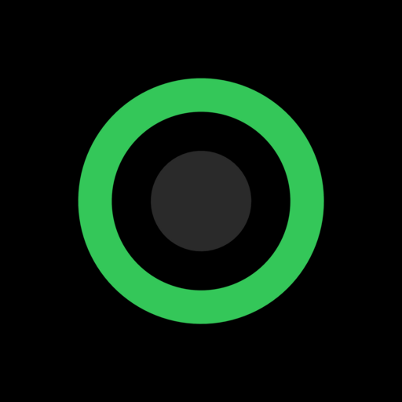
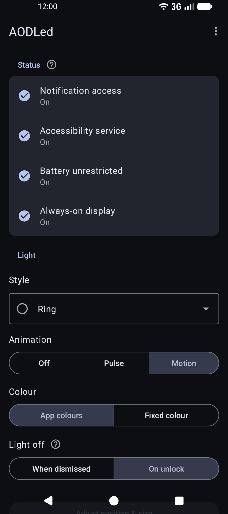
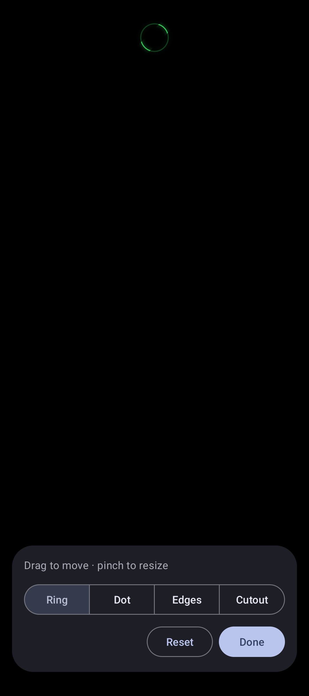

<p align="center">
  
</p>

<h1 align="center">AODLed</h1>

<p align="center">
  <b>A notification LED for phones without one.</b><br>
  An always-on display with nothing on it but your notifications, in each app's colour.
</p>

<p align="center">
  <a href="https://github.com/7Ds7/AODLed/releases/latest"></a>
  <a href="https://apps.obtainium.imranr.dev/redirect?r=obtainium://add/https://github.com/7Ds7/AODLed"></a>
</p>

<p align="center">
  <a href="https://github.com/7Ds7/AODLed/releases/latest"></a>
  
  <a href="LICENSE"></a>
</p>

<p align="center">
  
  
</p>

## Features

- **Four styles:** a ring around the camera, a dot, an edge glow, or the cutout's own outline.
- **Still or animated:** a pulse, a swirl, a line tracing the cutout, a comet along the edges, or a still light to save battery.
- **App colours:** taken from each notification or app icon, or one colour of your choice.
- **Only what matters:** silent, ongoing and Do Not Disturb notifications stay dark. Works with Private Space.
- **Turns itself off:** when you dismiss the notification, or as soon as you unlock.
- **Drag to place:** a full-screen editor that uses the same drawing code as the always-on display.
- **Burn-in care:** the light moves a few pixels each time the screen turns off.
- **Private:** no internet permission, no tracking, and notification text is never read.

## Why

[HoleyLight](https://github.com/Chainfire/HoleyLight) by Chainfire had this idea first. It hasn't been updated in
three years and no longer works, so AODLed brings the idea back for current Android.

Like Chainfire, I'm building AODLed for myself: an always-on display that is completely black, with nothing on it
but a notification light. It's deliberately bare, and I want to keep it that way.

Pull requests are welcome, especially fixes and support for other phones. New features need a good reason to exist,
so please open an issue to talk about one before you build it.

## Works on

Pixel 10a with GrapheneOS (Android 17). Needs Android 12 or newer.

**Tried it on another phone?** [Open an issue](https://github.com/7Ds7/AODLed/issues) with the model, Android version
and whether the light works.

## Install

- **GitHub:** download `AODLed-<version>-release.apk` from [Releases](https://github.com/7Ds7/AODLed/releases/latest).
- **Obtainium:** use the badge above, or add `https://github.com/7Ds7/AODLed`, to get updates automatically.
- **F-Droid:** submitted, expected early 2027.

Every channel ships the same APK signed with the same key, so you can switch channels without reinstalling.
Certificate SHA-256: `9b:c1:75:87:5c:de:a6:72:a4:30:d5:69:ec:7b:f3:74:64:ed:4a:95:f2:28:03:eb:fb:69:88:96:bf:3c:18:c0`

## Setup

Open AODLed. The Status card lists what's missing, and tapping a row takes you to the right setting.

| Permission | Why |
|---|---|
| Notification access | To see pending notifications and their colours. The text is never read. |
| Accessibility service | To draw over the always-on display. It doesn't read the screen. |
| Battery unrestricted | So Android doesn't stop the light while the phone sleeps. |
| Always-on display | The system setting itself. |
| Notifications | Only for the test notification (Android 13+). |

**Toggle greyed out?** Android restricts settings for sideloaded apps: go to App info → ⋮ → *Allow restricted settings*.

## Building

```
./gradlew assembleDebug
./gradlew testDebugUnitTest
```

Needs JDK 17+ (releases use JDK 21) and the Android SDK. Release signing reads `keystore.properties` in the repository
root (`storeFile`, `storePassword`, `keyAlias`, `keyPassword`). Without that file you get an unsigned APK, which is
what F-Droid builds and compares against the signed release.

## License

[GPL-3.0-or-later](LICENSE). Copyright (C) 2026 BinaryUnit.
